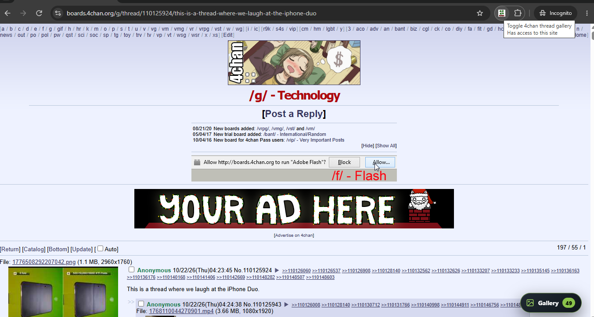
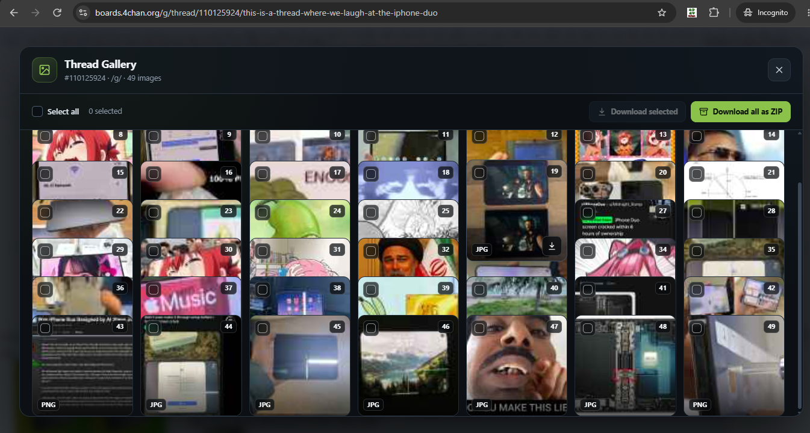
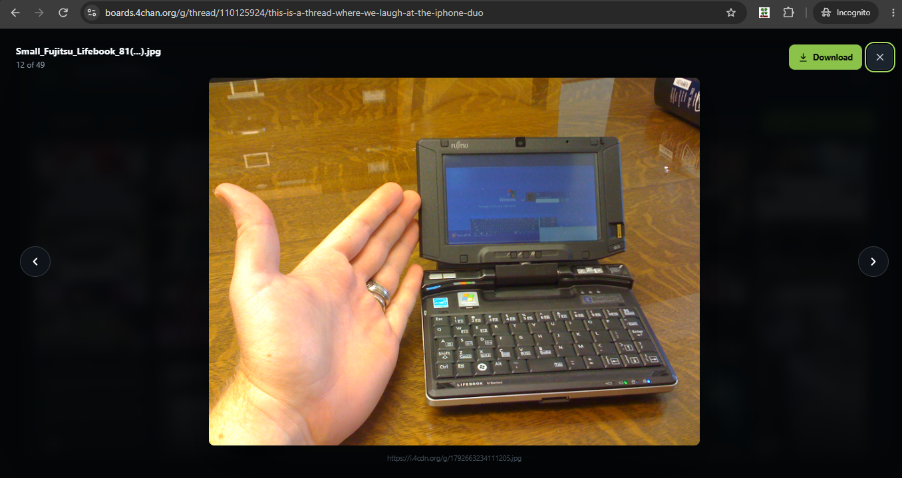

# 4chan-thread-gallery
Browse every image in a 4chan thread as a gallery and download images individually, selected, or as a ZIP.

<table align="center">
<tr>
<td align="center"> <b>A 4chan thread</b></td>
<td align="center"> <b>Gallery Display</b></td>
<td align="center"> <b> Toggle images</b></td>
</tr>
</table>

## Get Started
- Go to `chrome://extensions`
- Switch to `Developer Mode` (on the top right)
- Clone the repo
- Click on `Load Unpacked` in the `chrome://extensions` and select this repo folder
- Go to a 4chan thread, you can either click on the Gallery button on the bottom right or the Extension to open the Gallery.

## Features
- Toggle images in a thread page.
- Download single image.
- Download selected images.
- Download all images.
- *FREE*

